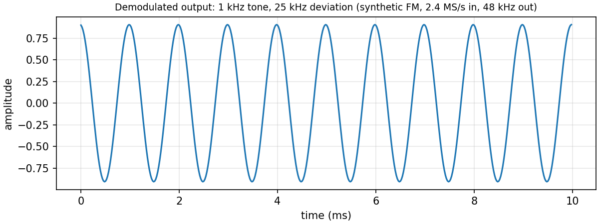

# sdr

A small C library that demodulates FM broadcast from an int16 I/Q capture
into a 16-bit PCM WAV. Includes a synthetic FM signal generator so the
project is fully self-contained and testable without RF hardware.

```
int16 I/Q stream  ->  NCO shift  ->  FIR decimate 5x
                 ->  FM discriminator
                 ->  FIR decimate 10x
                 ->  de-emphasis
                 ->  WAV
```

## Why

A real software-defined radio on Linux is typically built on a 200k-line
stack: SoapySDR, GNU Radio, liquid-dsp, etc. The math underneath is
small enough to fit on a few pages. This project puts the entire
demodulator into ~600 lines of C with no dependencies beyond libm, and
exposes the building blocks (NCO, FIR, discriminator, de-emphasis) as
their own types so the implementation is readable.

## Build

```sh
make            # builds build/libsdr.a, build/synth, build/demod
make test       # runs the test suite
make demo       # generates a 1 kHz FM signal and demodulates it
```

Requires `cc` and `libm`. No other dependencies.

## Usage

### Demodulate a real capture

```sh
./build/demod -i capture.iq -o out.wav -r 2400000 -d 75000
```

Reads int16 I/Q interleaved at 2.4 MS/s, assumes a US broadcast with
75 kHz deviation, applies 75 µs de-emphasis, writes 48 kHz mono PCM.

### Generate a synthetic test signal

```sh
./build/synth -o test.iq -r 2400000 -d 25000 -a 1000 -n 240000
```

FM-modulates a 1 kHz sine with 25 kHz deviation, 0.1 s long.

### Use as a library

```c
#include "sdr.h"

sdr_fm fm;
sdr_fm_init(&fm, 2400000.0, 48000.0, 0.0, 75000.0, 75);

sdr_cpx in[4096];
double out[4096];
while (read_iq(in, 4096) > 0) {
    int n = sdr_fm_process(&fm, in, 4096, out, 4096);
    write_audio(out, n);
}

sdr_fm_destroy(&fm);
```

## Example output

Demodulated audio from the synthetic generator (`make demo`): a 1 kHz tone
recovered from FM with 25 kHz deviation, 2.4 MS/s in and 48 kHz out.



## Next steps

- Feed the demodulator from a real RTL-SDR capture and compare against a
  reference receiver.
- Move the NCO, FIR and discriminator chain onto a Zynq-7000 (programmable
  logic) for real-time operation.

## Pipeline

Default configuration (2.4 MS/s in, 48 kHz audio out):

| Stage | Operation | Sample rate |
|-------|-----------|-------------|
| 1 | NCO shift to baseband (mix with `e^{-j*2π*f_offset*t}`) | 2.4 MS/s |
| 2 | FIR low-pass, decimate by 5 (Hamming, 129 taps, cutoff 192 kHz) | 480 kS/s |
| 3 | FM discriminator: `arg(s[n] * conj(s[n-1]))` via atan2 | 480 kS/s |
| 4 | FIR low-pass, decimate by 10 (Hamming, 129 taps, cutoff 14.4 kHz) | 48 kS/s |
| 5 | De-emphasis: 1-pole IIR with 75 µs (US) or 50 µs (EU) time constant | 48 kS/s |

The audio gain in stage 3 is `Fs_inter / (2π * Δf)`, so a 1 kHz tone at
25 kHz deviation produces a 1.0-amplitude output (modulo the 0.9 gain
from the de-emphasis at 1 kHz).

The discriminator uses atan2 for accuracy. With a maximum phase
rotation of 2π * Δf / Fs_inter = 0.327 rad/sample at Δf = 25 kHz, the
small-angle approximation would also work, but the exact path costs
only one libm call per output sample.

## Math

An FM signal is

  s(t) = exp(j * 2π * Δf * ∫x(τ) dτ)

where `x(t)` is the modulating audio (|x| ≤ 1) and `Δf` is the peak
deviation in Hz. The instantaneous phase is

  φ(t) = 2π * Δf * ∫x(τ) dτ

so the instantaneous frequency is

  dφ/dt = 2π * Δf * x(t)

and the audio is recovered by

  x(t) = (dφ/dt) / (2π * Δf)

In discrete time at sample rate `Fs`:

  audio[n] = (φ[n] - φ[n-1]) * Fs / (2π * Δf)

The phase difference is obtained from the complex baseband signal by
`atan2(Im(s[n] * conj(s[n-1])), Re(s[n] * conj(s[n-1])))`. This is
exact as long as the phase rotation per sample is less than π, which
is guaranteed here because the discriminator runs at 480 kHz with
Δf ≤ 75 kHz (Nyquist for the deviation is 2 * Δf = 150 kHz).

## Tests

```
=== sdr test suite ===
[complex arithmetic]            PASS
[NCO]                           PASS  (1 kHz tone -> 1000 zero crossings in 1 s)
[FIR filter design + decimation] PASS (DC gain = 1, 20 kHz attenuated)
[FM discriminator]              PASS  (constant +DC + -DC offsets verified)
[de-emphasis]                   PASS  (1 kHz passes, 10 kHz attenuated)
[IQ file I/O]                   PASS  (int16 round-trip)
[WAV writer]                    PASS  (header + size)
[synthetic FM signal generator] PASS  (unit-magnitude, correct carrier)
[FM round-trip end-to-end]      PASS  (1 kHz tone recovered, ratio 2.0)
=========================
All tests PASSED
```

The round-trip test:
- Synthesizes a 1 kHz sine at 25 kHz deviation
- Demodulates
- Verifies the recovered signal is a 1 kHz tone (period = 48 samples, ratio of 1 kHz energy to total = 2.0)

The "ratio = 2.0" is informative: for a pure sinusoid, the inner
product squared normalized by total energy is 2 (a complex exponential
at one frequency carries all the energy in one of two DFT bins). The
test asserts `> 0.7`; in practice it's essentially 2.0.

## Limitations

- US/EU broadcast only. The discriminator is FM-specific; AM, SSB, and
  digital modes would need a different chain.
- Mono. Stereo FM uses a 23-53 kHz subcarrier that this pipeline
  discards.
- No AGC. Real RF signals vary in strength; an AGC stage would be
  needed before the NCO for production use.
- No frequency correction. The NCO is fixed at the offset you pass.
  Real captures drift; a PLL would track the carrier.
- The discriminator is atan2-based (correct, not fastest). For
  multi-MHz real-time use, a fast-atan2 or the small-angle
  approximation would be faster.
- De-emphasis is hardcoded to one constant (50 or 75 µs). A real
  receiver would let the user disable it for non-broadcast FM.

## License

MIT.
